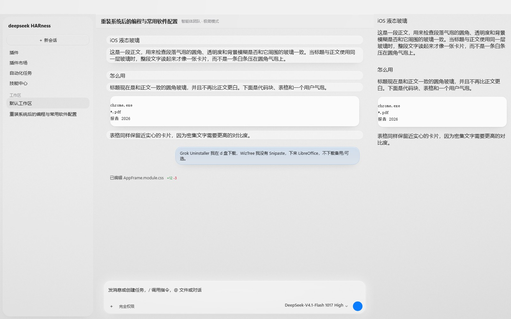
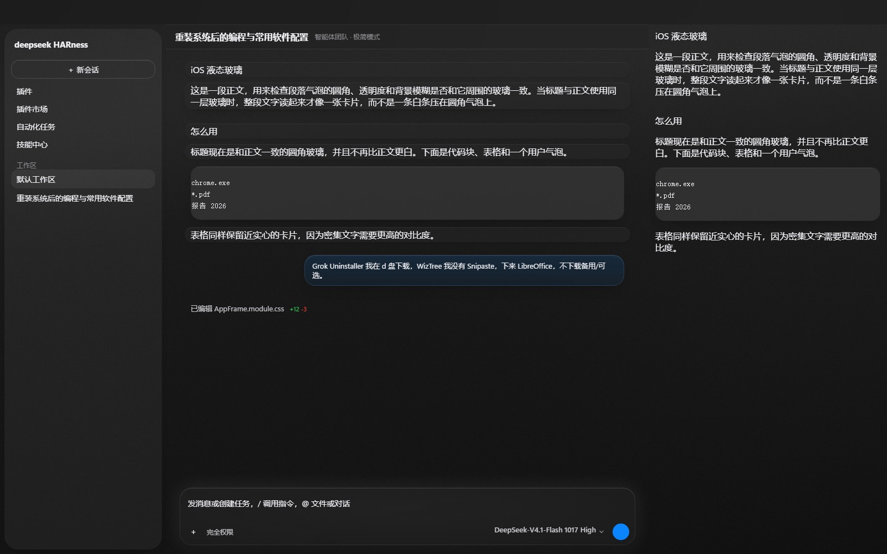

# iOS Liquid Glass — a DeepSeek Harness skin

A Liquid Glass skin for the DeepSeek Harness Web client, modelled on iOS 26: the whole window is one frosted sheet over a low-saturation mesh wallpaper.

The window carries exactly one layer of frost: the wallpaper is blurred once at the bottom of the window, the three columns themselves are transparent, and the sidebar card, the prose plates, the code blocks and the composer each float on that sheet as a flat tint. System blue is the only accent, radii and hairlines follow system-control proportions, and there is exactly one moving part — a 21-second specular sweep across the session header, which stops under reduced motion.

The skin itself is declarative (`skin.json` plus two stylesheets and two wallpapers), and the same repository installs as a DSH client plugin. The plugin form is dependency-free, requires no shared module, and only appends three `<style>` elements to the document.

- skin id: `ios-liquid-glass`
- plugin package: `dsh-skin-liquid-glass`
- repository: <https://github.com/liushuchang-2012/dsh-skin-liquid-glass>
- license: MIT

## Screenshots

| Light | Dark |
| --- | --- |
|  |  |

Both are 1600×1000 captures of the running interface at background occlusion 0.

## Features

### Four material tiers

The material has four tiers. The values below come from `:root` and `body[data-ds-dark-theme]` in `patches.css`; fills are the alpha at background occlusion 0 (wallpaper fully visible):

| Tier | Surfaces | Blur · saturation | Fill (light / dark) |
| --- | --- | --- | --- |
| T1 sheet | the whole window: sidebar, conversation, right column, session header, Windows title strip | 30px · 150%, once for the whole window | `--ios-lg-chrome` .16 / .28 |
| T2 content | prose paragraphs and headings, quotes, lists, code blocks, tables, user bubble | none — flat tint on the sheet, with inner rim and shadow | `--ios-lg-plate` .40 / .42; code blocks and tables `--ios-lg-plate-solid` .80 / .82; sidebar card `--ios-lg-sidebar-fill` .14 / .05 |
| T3 controls | composer card, chips, queue dock | 30px · 150% | `--ios-lg-control-fill` .56→.42 / .54→.42 (radial gradient) |
| T4 overlays | dialogs, toasts, menus, diff hover preview, floating windows | 40px · 150% | `--ios-lg-overlay` .94 / .94 |

Radii follow the same tiers: 24px for the sidebar card (all four corners, with an 8px margin on every side), 22px for the composer, 18px for dialogs, 16px for code blocks and tables, 14px for prose plates (18px for headings), 14px for the menu backing. Menus and dropdowns keep the shell's own material — the skin only supplies the glass around them.

All four tiers share one edge treatment: `--ios-lg-rim` is an `inset 0 1px 0` specular rim (`rgba(255,255,255,.78)` light, `.10` dark), `--ios-lg-hairline` is the separator line (`rgba(60,60,67,.06)` light, `rgba(255,255,255,.08)` dark), shadows come in two steps, `--ios-lg-shadow` and `--ios-lg-shadow-lift`, and prose plates use `--ios-lg-plate-shadow` — a large negative spread keeps the edge clean instead of drawing a dark band along the seam.

### Wallpaper and occlusion

The two wallpapers are 2560×1440 neutral grey mesh gradients (`assets/ios-liquid-light.jpg` and `assets/ios-liquid-dark.jpg`, R=G=B, channel means around 230 and 27), so the glass never picks up a colour cast. The only saturated colour in the UI is system blue, `#0a7cff` light and `#0a84ff` dark.

The fills of the shell, the prose plates, the sidebar card and the composer all read `--dsw-skin-scrim` (0–1, driven by the skin center's background-occlusion slider); overlays stay near-solid and do not follow it. Occlusion 0 is the designed-for state; at 1 the shell glass goes from .16 to .36 (`--ios-lg-chrome`, dark .28→.50), prose plates from .40/.42 to .56/.58, and the composer centre from .56 to .78. Columns, header and prose thicken together instead of drifting apart between slider stops.

### Reduced-transparency fallback

Under `prefers-reduced-transparency: reduce` the plate layers — prose, code blocks, session header, composer, and the window sheet under the Windows title strip — switch to a solid `--dsw-alias-bg-layer-1` and drop `backdrop-filter`, while the composer and the user bubble switch to layer 2. Under `prefers-reduced-motion: reduce` the specular sweep is removed outright (`animation: none`, no background image). Both are pure CSS; no JavaScript is involved.

### Plugin form

`package.json` declares `dsh.bundle.patch` and `dsh.client`. The host half, `lib/index.js`, is an empty `apply()` whose only job is to mount a fiber so the client bundle can reach `window.__DSH_BOOT__`. The client half, `client.js`, is a build artifact shaped like `window.__ModuleLoader__.load({ id, factory })` with an empty `inject` array: it injects three `<style data-plugin-css=…>` layers (tokens, material, wallpaper) and removes all three on teardown, hot reload or profile switch.

## Design notes

### Two layers, two jobs

`skin.css` is the token layer. It only re-maps the shell's own `--dsw-*` and `--aion-*` design tokens (contracts in `contracts/official-tokens-v1.json`), one set for light and one under `body[data-ds-dark-theme]`. Every surface that should read as glass is a translucent `rgba()` whose alpha comes from `--dsw-skin-scrim`, so the three columns and the panels thicken together instead of drifting apart.

A token cannot carry a `backdrop-filter`, and frosting cannot dodge the positioning trap described below, so the material lives in `patches.css`: blur, saturation, specular inner rim, radii, hairline separators, and the single animation.

### Why large containers are not frosted directly

`backdrop-filter` makes an element a containing block, exactly like `filter` and `transform`. The shell renders icon hover tooltips as `position: fixed` spans inside action rows and inside the composer card; put a filter on those boxes and the tooltips detach from their buttons and land in the scrollport.

Blur therefore only ever rides a `::before` plate, which has no descendants: once at the bottom of the window, once on the session header. The composer takes its frost from the `[data-dsh-composer-frost]` follower the skin center mounts, and the `::before` in `patches.css` is only a fallback for when that follower is absent. Overlays — menus, dialogs, toasts — are leaves and carry the filter themselves.

Prose, code blocks and tables also draw on a `::before` plate, but for fill, inner rim and shadow rather than blur: the window is already frosted once, and a second filter would only re-sample it. Prose plates grow outward with negative insets (`-.18em -.7em`), so the copy keeps the shell's own text column and the rounding never collides with the first glyph.

### One frost for the whole window

The columns themselves are transparent: inside the sidebar's scope `--dsw-specific-sidebar-fill` is neutralised, its `background` is cleared, `border-right` is dropped, and the conversation and right columns stop painting a base of their own. The wallpaper is blurred exactly once, on `[data-dsh-frame]::before` (`--ios-lg-chrome`, 30px, 150%), and the columns and cards float on that sheet under hairline separators.

When each column frosted itself, neighbouring layers sampled different parts of the wallpaper — the sidebar sat on the darkest corner, so an identical white fill still came out a step apart and the junction showed a hard edge. With a single sample, there is no difference left to read at the seam.

The sidebar is a flat tinted card on that sheet: `margin: 8px` leaves the sheet visible on all four sides, the radius is 24px, the fill is `--ios-lg-sidebar-fill` (`.14` light; a 5% white veil in dark), and the shadow leans left and down so it never paints onto the conversation column. The card carries no `backdrop-filter` of its own, so there is no second sample to take.

### The glass follows the wallpaper

Glass is translucent, so a column's tone is whatever wallpaper sits behind it. The wallpapers are neutral grey, which means the glass only shifts in luminance, never in hue; it also means that changing the wallpaper moves every sample and `--ios-lg-chrome` and `--ios-lg-sidebar-fill` have to be retuned with it. The values in this repository are tuned to the two bundled wallpapers: the shell and the sidebar deliberately sit at the same luminance (.16 against .14 in light), because a larger difference reads as two different greys in the window.

## Installation

Pick one of the three paths below. The first two install the same skin; do not enable both at once — the same rules would stack twice and the wallpaper would be painted twice.

### Through the skin center

Copy the repository into the user skin directory; the default location is:

```
%USERPROFILE%\.dsh\skins\ios-liquid-glass\
```

The directory name must match the `id` in `skin.json`. The skin center picks it up without a restart:

```powershell
git clone https://github.com/liushuchang-2012/dsh-skin-liquid-glass.git `
  "$env:USERPROFILE\.dsh\skins\ios-liquid-glass"
```

Then enable it under Settings → Skin → iOS 液态玻璃. The skin center itself calls `POST /api/skin-center/v2/active` with `{"active":"ios-liquid-glass"}`; pass `null` as `active` to return to the official default.

### As a client plugin

```bash
dsh plugin --profile <name> add <path-or-package>

# example: install from a local checkout
dsh plugin --profile <name> add "D:\path\to\dsh-skin-liquid-glass"

# remove
dsh plugin --profile <name> remove dsh-skin-liquid-glass
```

`<name>` is the target profile, `web` by default; `<path-or-package>` is either an absolute local path or a package spec such as `github:user/repo`. Reload the page after installing. In plugin form `client.js` paints the wallpaper and the scrim itself, so the skin center is not involved.

### Local development

```bash
npm run build               # generate client.js from src/client.template.js
npm test                    # 14 checks
npm run build -- --check    # only verify client.js matches the sources
```

Re-run `npm run build` after touching `skin.css`, `patches.css`, `assets/` or `skin.json`: `client.js` is a build artifact, hand edits are overwritten on the next build, and every install path ships the built copy. The fastest way to check a change while editing is to `dsh plugin add` the local directory, rebuild, then reload the page.

### Removing and reverting

- Skin center: pick the official default under Settings → Skin, or delete `%USERPROFILE%\.dsh\skins\ios-liquid-glass\` entirely and reload.
- Plugin: `dsh plugin --profile <name> remove dsh-skin-liquid-glass`, then reload the page.
- Temporarily off: set `localStorage["dsh-skin-liquid-glass.enabled"]` to `"0"`, as described under Configuration.

## Configuration

### Background occlusion

`--dsw-skin-scrim` (0–1) is the single fill master switch, written by the skin center's background-occlusion slider. 0 is the thinnest state with the wallpaper fully visible; at 1 the panels fill in past .90. In plugin form there is no slider, the variable falls back to the CSS default of 0, and the glass stays at its thinnest; to pin another level, set the same custom property on `body`.

The user bubble has two knobs of its own: `--dsh-skin-bubble-alpha` (default .5) and `--dsh-skin-bubble-blur` (default 10px), also supplied by the skin center.

### On/off flag

The plugin form persists its enabled state in `localStorage["dsh-skin-liquid-glass.enabled"]`, on by default; any value other than `"0"` or `"false"` counts as enabled. The client bundle exports `setEnabled(enabled)` for programmatic use; the shortest route from the page is to write the key and reload:

```js
localStorage.setItem("dsh-skin-liquid-glass.enabled", "0");
```

The flag deliberately does not go through `dsh-settings`: the host apiproxy only serves an allowlisted set of settings namespaces, and a third-party namespace would answer `settings-not-exposed`. Keeping it in localStorage keeps the skin self-contained.

### Wallpaper and scrim

Artwork and scrim live in `skin.json` under `contributes.backgroundMedia.{light,dark}`: `src` points at the full-size image in `assets/`, and `scrim` is a `radial-gradient` / `linear-gradient` list stacked over it. At build time `scripts/build.mjs` bakes those two fields, both stylesheets and the two 1600×900 compressed wallpapers into `client.js`; the skin-center path reads `skin.json` directly instead.

## Compatibility and limitations

- **DSH version**: `package.json` declares no `engines` range, so nothing is enforced at install time. The build was verified against DSH `0.2.0-rc.2`.
- **Platform**: verified on Windows. The Windows shell rounds off the chat column's top-left corner, cutting a notch where the sidebar meets it; one dedicated rule (`[data-windows-titlebar]`) squares that corner, and the same corner of the fullscreen right panel with it. The rule matches no element on other platforms, and there is no other platform-specific code in the repository.
- **macOS / Linux**: not tested. Every `backdrop-filter` in the stylesheets also ships a `-webkit-` prefix, `prefers-reduced-transparency` is covered, and the font stack prefers `SF Pro Text` / `-apple-system` before falling back to `Segoe UI` — but rendering has not been checked on those systems.
- **What is not changed**: geometry and interaction. Apart from radii, margins, inner rims, fills and shadows, padding, widths and scroll structure are untouched. Selectors are either `--dsw-*` token aliases or `[class*="_suffix"]` matches, there is no `hooks.mjs`, and no shell event is observed.
- **Visual tuning follows the wallpaper**: the bundled wallpaper is neutral grey and the fills of the columns, prose plates and bubble are tuned to it. A different wallpaper moves every sample and requires retuning `--ios-lg-chrome`, `--ios-lg-sidebar-fill` and `--ios-lg-plate`.

## Verification

`npm test` runs `node --test`: 14 checks, no dependencies.

- **Bundle lifecycle (7)**: exactly one loader entry, under the package id; the factory requires no shared module and exports `apply` / `setEnabled` / `inject`; `apply()` paints three `<style>` layers and teardown retracts all of them; a second `apply()` produces no duplicate layer; `setEnabled(false)` retracts, writes `"0"`, and the next `apply()` honours it; the bundle works without a theme service and without `ctx.effect`; `client.js` stays under 400 KB.
- **Packaging wiring (7)**: `package.json` declares the dsh bundle patch and the web client with an empty `inject`; `main`, the root export, `./client` and every `files` entry exist on disk; the roster patch mounts the package by its own name; `client.js` is byte-for-byte the current build; `skin.json` declares both layers, both palettes and their artwork and previews; `screenshots.json` holds 1–8 entries; both READMEs document the plugin install path and `LICENSE` exists.

`node scripts/build.mjs --check` can also be run on its own to confirm that `client.js` is not stale; it exits non-zero with `client.js is stale — run: npm run build` when the artifact no longer matches the sources.

Light and dark were both reviewed block by block at 1600×1000; `preview/light.jpg` and `preview/dark.jpg` are the renders taken then.

The suite covers the loading contract and the packaging wiring, not the pixels: fills, blur radii and corner radii are checked visually in the running app and are not asserted. The skin-center side — directory scanning and stylesheet scoping — is likewise outside `npm test` and has to be seen installed.

## Repository layout

| Path | Role |
| --- | --- |
| `package.json` | package metadata, plus the `dsh.bundle` / `dsh.client` declarations |
| `skin.json` | skin manifest v2: id, name, accent, previews, stylesheet and patches, wallpaper and scrim |
| `skin.css` | token layer — remaps the shell's `--dsw-*` / `--aion-*` tokens (light plus `body[data-ds-dark-theme]`) |
| `patches.css` | material layer — blur, saturation, specular rim, radii, hairlines, the single animation |
| `assets/ios-liquid-{light,dark}.jpg` | full-size wallpapers, 2560×1440 |
| `assets/plugin-wallpaper-{light,dark}.jpg` | 1600×900 / q88 re-encodes, base64'd into the bundle at build time |
| `preview/{light,dark}.jpg` | real-interface captures used by the skin card and in this README, 1600×1000 |
| `screenshots.json` | screenshot list, relative to this directory |
| `lib/index.js` | host half: an empty `apply()` that only mounts a fiber |
| `cordis.patch.yml` | roster patch that mounts the package under its own name |
| `src/client.template.js` | client bundle template with build-time placeholders, not shipped as-is |
| `scripts/build.mjs` | zero-dependency builder: substitutes the placeholders and writes `client.js`; `--check` only compares |
| `client.js` | build artifact, `window.__ModuleLoader__.load({ id, factory })` |
| `tests/` | `node:test` cases: bundle lifecycle and packaging wiring |
| `SUBMIT.md` | release and submission notes |
| `LICENSE` | MIT text |

## License

MIT, see `LICENSE`; the copyright line reads `ios-liquid-glass contributors`.

The design language comes from Apple's Liquid Glass. The repository contains no third-party code; the wallpapers are neutral grey mesh gradients and the preview images are captures of the DSH Web UI with this skin applied.
